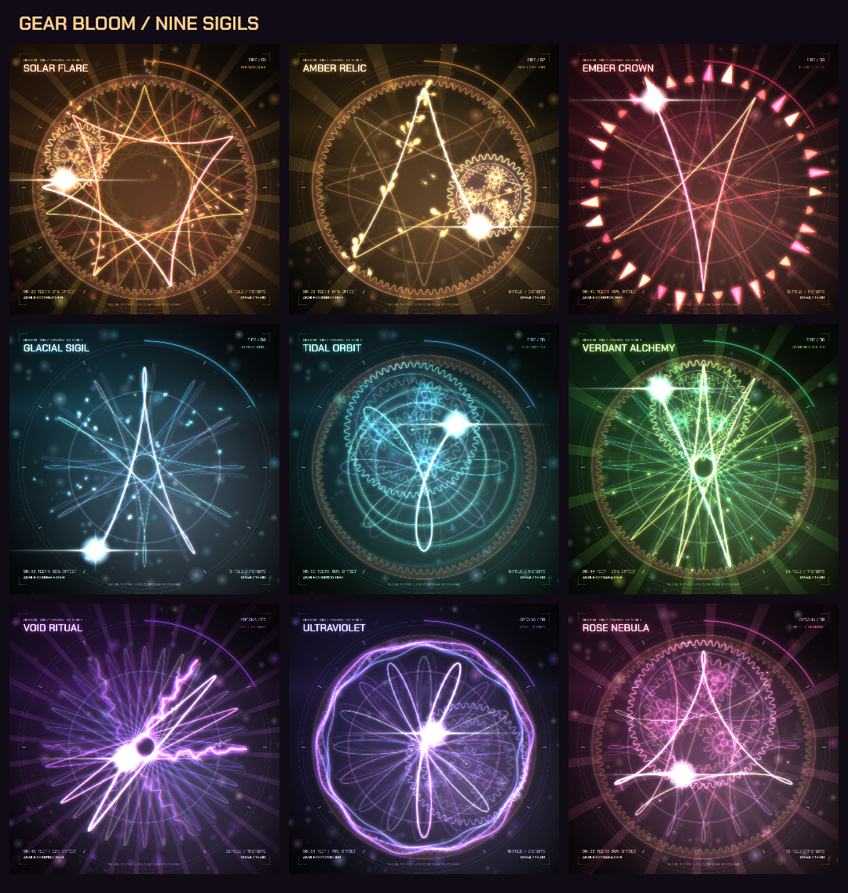

# Generative Sigils · GEAR BLOOM

Turn rolling gears into luminous geometry. GEAR BLOOM is a browser drawing instrument, a local video renderer, and a **project-local Codex skill** for creating mechanical sigils with color, particles, lightning and procedural sound.

Everything renders locally. No backend, AI API, remote rendering service or account is required to play or export artwork.



[Example clips and clock](examples/README.md) · [Skill instructions](.agents/skills/generative-sigils/SKILL.md) · [Prompt and render recipes](.agents/skills/generative-sigils/references/examples.md)

## Try the browser instrument

Requires **Node.js 20.19+ or 22.12+** and npm. Run these commands in the cloned project:

```sh
git clone https://github.com/tutao0123/generative-sigils.git
cd generative-sigils
npm ci --cache .cache/npm
npm run dev -- --host 127.0.0.1 --port 4173 --strictPort
```

Open [localhost:4173](http://127.0.0.1:4173/). Change the gear's tooth count, pen offset, speed and palette; explore presets; toggle the mechanism and procedural effects; export a complete 1600 × 1800 PNG.

Keyboard shortcuts: **Space** play/pause, **R** redraw, **M** mechanism, **F** immersive view, **Esc** close help or exit immersive view. Dials and sliders support arrow keys.

The [clock example](http://127.0.0.1:4173/examples/clock.html) uses three concentric rings for hours, minutes and seconds, with four shared palettes. It runs in the same local browser server. See [example details](examples/README.md) for the source and previews.

## Use the project-local skill

Open this repository as your Codex project. The skill is already included at `.agents/skills/generative-sigils/SKILL.md`; keep it there and invoke `$generative-sigils` in a conversation:

```text
$generative-sigils Create nine 15-second mechanical sigil videos in three
groups of three: Fire, Tide and Arcana. Give each design its own palette
and procedural effect. Start with PNG proofs, then render with sound to
exports/my-nine-sigils.
```

The repository includes the renderer the skill uses, so the skill does not need a separate installation. It reads and modifies files in this project and writes outputs inside it. Its workflow excludes global configuration changes, global skill installation, external services, uploads and posting. Sharing the resulting files is a separate, manual action.

The skill does **not** change permissions. It supplies scoped instructions, rather than an operating-system sandbox. The renderer also rejects output paths outside the project, including paths that escape through existing symlinks or junctions.

## Render artwork and video

PNG proofs need the project dependencies only. Video rendering additionally requires existing **`ffmpeg` and `ffprobe` commands on PATH**, with an FFmpeg build supporting `libx264` and AAC. These instructions do not install or configure global tools.

Review all nine designs as stills first:

```sh
node scripts/render-sigils.mjs --all --proof --size 1080 --phase 0.17 --out exports/my-proofs
```

Render one design, or the full collection:

```sh
node scripts/render-sigils.mjs --id 01-solar-flare --duration 15 --size 1080 --fps 30 --out exports/my-solar-flare
node scripts/render-sigils.mjs --all --duration 15 --size 1080 --fps 30 --out exports/my-nine-sigils
```

Default output is a **15-second, 1080 × 1080, 30 fps H.264/yuv420p MP4** with a locally synthesized stereo AAC soundtrack. The cinematic renderer adds luminous trails, color flow, bloom and motion on a 120 BPM grid. The nine designs are arranged into `fire/`, `tide/` and `arcana/`, three videos per chapter.

Each collection includes PNG posters, `contact-sheet.png`, `manifest.json` and an editable English `posting-plan.md`; video runs also include a local `index.html` gallery. Generated outputs stay in ignored `exports/`. The tracked [examples](examples/README.md) provide small previews; generate the full collection locally.

Useful options:

| Option | Purpose |
| --- | --- |
| `--proof` | PNG review without MP4 rendering |
| `--no-audio` | Silent MP4 |
| `--style classic` | Earlier, simpler visual renderer |
| `--phase 0.17` | Poster/proof phase, from 0 inclusive to 1 exclusive |
| `--jobs 1` | Render one video at a time; default automatically uses up to six workers |
| `--mux` | Add procedural audio to existing selected MP4s, preserving their encoded picture |
| `--overwrite` | Explicitly replace existing selected MP4s |

Choose a fresh output folder for each variation. Existing MP4s are protected unless `--overwrite` is supplied; rerunning proofs refreshes PNGs and collection metadata. `--id` and `--all` are mutually exclusive. See `node scripts/render-sigils.mjs --help` for current options.

## Nine designs, three chapters

| Chapter | Preset ID | Design | Effect |
| --- | --- | --- | --- |
| Fire | `01-solar-flare` | Solar Flare | Sparks |
| Fire | `02-amber-relic` | Amber Relic | Molten splash |
| Fire | `03-ember-crown` | Ember Crown | Flame corona |
| Tide | `04-glacial-sigil` | Glacial Sigil | Crystal dust |
| Tide | `05-tidal-orbit` | Tidal Orbit | Ripples |
| Tide | `06-verdant-alchemy` | Verdant Alchemy | Fireflies |
| Arcana | `07-void-ritual` | Void Ritual | Lightning |
| Arcana | `08-ultraviolet` | Ultraviolet | Plasma |
| Arcana | `09-rose-nebula` | Rose Nebula | Stardust |

Customize colors in `src/palettes.js` and designs in `src/video-presets.js`. A preset's `effectId` selects an effect from `src/effects.js`; there is no `--effect` CLI flag. Set `look.gears` to hide or show nested mechanisms, keep `look.laps` an integer for loop closure, and use `sound` to choose the soundtrack's root and scale.

## Mathematics and repeatable motion

A gear with `n` teeth rolls inside a fixed ring with `N = 96` teeth. With `R = 1`, `r = n/N`, and pen distance `d = offset × r`, its pen follows a [hypotrochoid](https://mathworld.wolfram.com/Hypotrochoid.html):

```text
cx = (R-r) cos θ           cy = (R-r) sin θ
φ  = -(N-n) θ/n
x  = cx + d cos φ          y  = cy + d sin φ
```

The complete curve closes after `n/gcd(N,n)` orbits. Gear positions and artwork use the same geometry; changing speed changes playback rather than the shape.

Exported frames derive from normalized loop phase and preset configuration. Seeded variation and periodic motion let effects render repeatably, including out of order, without live randomness or an accumulating particle simulation. The default loops and local soundtrack are designed to meet at the loop boundary.

This engine is also a starting point for animated emblems, album visuals, stream backgrounds, game spell circles and mathematical teaching tools. The clock example maps the same visual language to live time; more experimental displays could use gear ratios to visualize timers or rhythm.

## Develop

```sh
npm run build
npm test
```

The browser app lives in `src/App.jsx` and `src/Instrument.jsx`; shared geometry, Canvas rendering, cinematic motion, effects and sound live in `src/core.js`, `src/render.js`, `src/cinematic.js`, `src/effects.js` and `src/soundtrack.js`. The render CLI is `scripts/render-sigils.mjs`; the clock example is `examples/clock.html` with `src/clock.js`.

The app builds to `dist/client`; `dist/server` and `.openai/hosting.json` support the included Sites deployment scaffold. No deployment or publication happens as part of the skill workflow.

## License and credits

Source code and project-created examples are available under the [MIT license](LICENSE). The bundled Chakra Petch fonts retain their [SIL Open Font License](public/assets/FONT-LICENSE.txt). See [third-party notices](THIRD_PARTY_NOTICES.md) and [texture notes](public/assets/asset-notes.md) for attribution and the generated panel background.

The instrument's visual direction was inspired by [Parallel Web Systems' original post](https://x.com/p0/status/2089506588067520842). The original reference image is not included in this repository.
