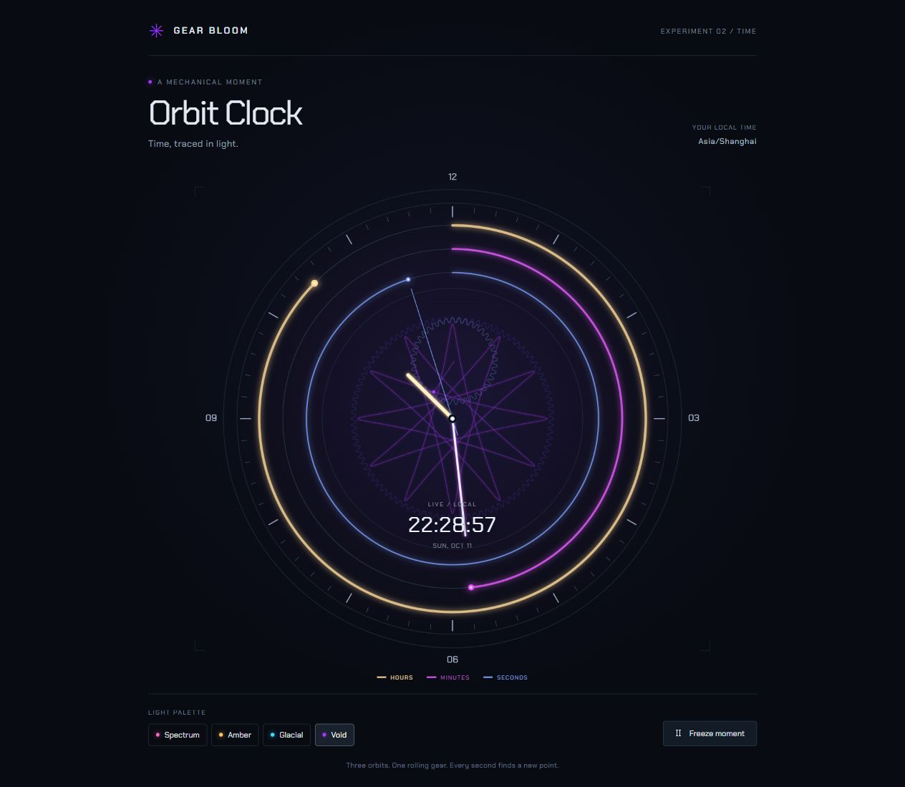

# Examples

All examples are generated locally with the shared gear geometry, palettes and
procedural effects. The bundled MP4s are compact 15-second, 540 × 540, 30 fps
H.264/AAC previews of the full-resolution renders.


| Chapter | Preview | Recipe |
| --- | --- | --- |
| Fire | [Solar Flare](solar-flare.mp4) | `--id 01-solar-flare` |
| Tide | [Tidal Orbit](tidal-orbit.mp4) | `--id 05-tidal-orbit` |
| Arcana | [Void Ritual](void-ritual.mp4) | `--id 07-void-ritual` |

The previews retain their procedural stereo soundtrack. The collection image
shows all nine curated designs; full-size MP4s are generated into ignored
`exports/` directories rather than committed to Git.

## Make your own

Run from the repository root after `npm ci --cache .cache/npm`:

```powershell
# PNG proofs do not need FFmpeg.
node scripts/render-sigils.mjs --all --proof --size 720 --out exports/example-proofs

# Video needs existing ffmpeg and ffprobe commands on PATH.
node scripts/render-sigils.mjs --id 05-tidal-orbit --duration 15 --size 1080 --fps 30 --out exports/example-tide

# All nine designs, grouped into Fire, Tide and Arcana.
node scripts/render-sigils.mjs --all --out exports/example-nine
```

Each video run writes posters, a contact sheet, a manifest, a local playback
gallery and an English posting draft. Use a fresh output directory for each
variation. See the [skill recipes](../.agents/skills/generative-sigils/references/examples.md)
for invocation prompts and the [main README](../README.md) for prerequisites.

## Clock face



Start `npm run dev -- --port 4173 --strictPort`, then open
[the clock example](http://127.0.0.1:4173/examples/clock.html).
The standalone [clock page](clock.html) combines a mathematical sigil with
readable hour, minute and second tracks. Its color themes reuse the project's
shared palettes. It uses your browser's local time and needs no account or
external service. The normal build also includes this page.

This is a browser prototype; installing a native watch face would require a
separate platform-specific package.
